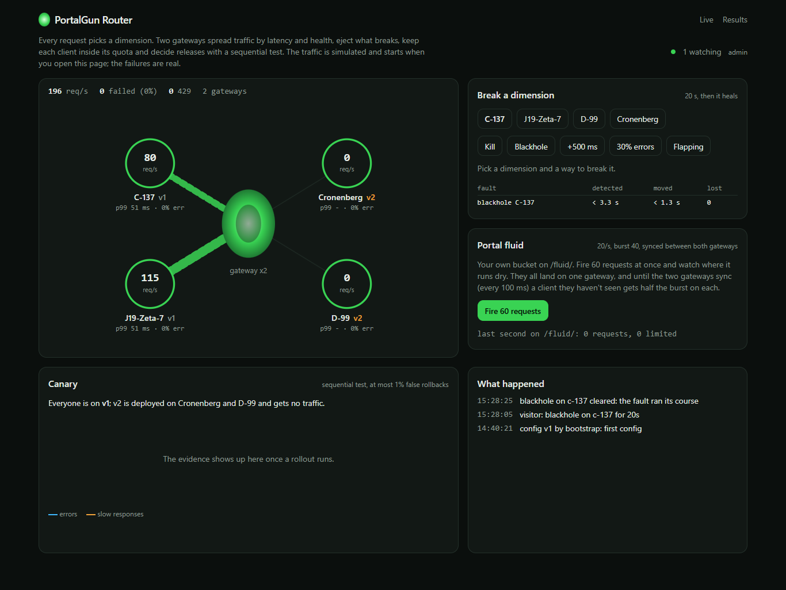

# PortalGun Router

Rick's portal gun opens a door to whichever dimension he points it at, and when that dimension is on fire, he points it somewhere else. An API gateway does the same job thousands of times a second, with a fraction of a millisecond to decide. I wanted to build one and find out what that fraction of a millisecond actually buys, measured against the gateways people run in production.

PortalGun is an HTTP reverse proxy in Go. It decides where each request goes from health, latency, rate limits and rollout rules, and changes that decision when something breaks. Next to it there's a small control plane (config versions, canary rollouts, chaos) and a Next.js dashboard.

Everything a gateway promises is a number: it adds little latency, it keeps a client inside its quota across several instances, it moves traffic off a dead upstream before many requests fail, and it catches a bad release without rolling back good ones. I built the project around those four numbers rather than a feature list, and each of them is measured against something real.

It's running at **[portalgun.najafov.dev](https://portalgun.najafov.dev)**. You can kill a dimension, slow one down, or start a canary rollout and break it, and watch traffic move. The numbers below are on the Results page too.



One thing up front: the "dimensions" are containers on one server with fault injection (Toxiproxy) in front of them. The failures are real TCP failures (refused, reset, blackholed connections, slow answers), and the gateway's reaction to them is real. The geography isn't. Every hop is a Docker bridge, and "regions" differ only by the latency I inject.

## How a request goes through it

1. If the gateway already holds 256 requests across all routes, answer 503 at once (below, under "Turning work away").
2. Match the route from an immutable config snapshot behind an atomic pointer, so a config change never takes a lock on the hot path.
3. Rate limit, with one of four designs (below).
4. Canary split, sticky per client.
5. Pick a dimension with power of two choices and peak EWMA, the way Finagle and Linkerd do it, skipping ejected dimensions and dimensions at their in-flight cap. If everything is at its cap, answer 503 at once instead of queueing.
6. Send the attempt with a per-try timeout through that dimension's own transport.
7. On a retryable failure, retry on a different dimension if the retry budget allows (retries can be at most 20% of requests over 10 s, so a dead pool can't triple the load).
8. Record the outcome for health, the canary and metrics.

The proxy itself is `httputil.ReverseProxy` with my own `Transport`, which picks the dimension per attempt, so retries move to another dimension without ReverseProxy knowing. I didn't rewrite hop-by-hop headers, streaming and upgrades myself: that's the code most likely to have subtle bugs, and the standard library has had years of them fixed.

Health is three mechanisms, because each catches what the others miss: active probes (find a dead dimension that gets no traffic), passive ejection from real traffic (5 failures in a row, or half of the last 50 attempts), and a panic threshold (if more than half the pool looks broken, ignore health and spread over everything, because a shared dependency failing would otherwise eject the whole pool). All of it is local to each gateway instance. Nothing on the request path depends on Redis or the controller.

## Does it work?

All of this was measured on my laptop (i7-1270P, a 16-vCPU WSL2 VM), with a CPU limit on every container and the proxy comparison on separate CPU sets. My own load generator is open-loop and measures latency from the scheduled send time, so a stall can't hide in the tail (the wrk2 correction); I checked it against vegeta and wrk2 first. Medians of three runs or more per cell, always on the charger. A laptop is noisier than a dedicated server, so I only compare numbers from the same session, and I say where the spread is too wide to conclude anything.

### What a proxy in the path costs

A GET with a 1 KiB response from an upstream that answers at once, so the only thing left to measure is the proxy. Every proxy gets one worker or thread on one vCPU and 256 MB, keep-alive to the upstream, and no access log.

| system | added p50 at 1k rps | p99 at 1k rps | CPU per request at 1k rps | highest rate it held | memory at 1k rps |
|---|---|---|---|---|---|
| nginx | +107 µs | 1.34 ms | 114 µs | 15k | 22 MB |
| HAProxy | +108 µs | 1.45 ms | 120 µs | 12.5k | 88 MB |
| Go `httputil.ReverseProxy`, 30 lines | +139 µs | 1.64 ms | 173 µs | 8k | 56 MB |
| PortalGun | +155 µs | 1.74 ms | 189 µs | 6k | 31 MB |
| Envoy | +207 µs | 1.97 ms | 224 µs | 6k | 107 MB |
| Caddy | +201 µs | 2.33 ms | 237 µs | 4k | 86 MB |

"Held" means p99 under 50 ms, under 0.1% errors and at least 95% of the target rate. With no proxy at all the lab itself tops out near 20k, so nginx's real maximum is somewhere above 15k. The rates go up in coarse steps, and that last column turned out to depend on the evening as much as on the proxy (more on that below).

What I take from this:

- My own code costs little next to net/http. PortalGun spends 1.03-1.09x the bare ReverseProxy's CPU per request at every rate up to 8k and adds 16 µs at p50 over it at 1k.
- nginx and HAProxy held roughly twice the rate on one core. At the same 6k they spend about 20% less CPU per request than PortalGun, and their cost keeps falling as load grows. That's roughly what I expected from C event loops with no garbage collector.
- Envoy surprised me. With one worker and its defaults it used more CPU per request than PortalGun at every rate and ran out of memory one step above 6k. That compares defaults, though: none of the proxies here has overload protection turned on, and Envoy in production usually runs with its overload manager.
- Past their maximum, the Go proxies and Envoy all fail the same way. Requests queue in memory until the container reaches 256 MB and starts swapping, and throughput falls to a few hundred rps, or the kernel kills it. nginx and HAProxy never got near the limit. My first sweep caught PortalGun doing this at 8k, and I spent a while suspecting my own code before the bare ReverseProxy did exactly the same at 10k. PortalGun capped requests in flight per dimension, but nothing capped what the gateway held in total, so it couldn't turn away work it had no room for. I added that afterwards; it has its own section below.

The table says PortalGun held one step less than the bare ReverseProxy, 6k against 8k, on 3-9% more CPU. That didn't add up, so I ran just the two of them again at 6k, 7k and 8k, three times each, on a night with everything else on the laptop stopped:

| rate | p99, ReverseProxy | p99, PortalGun | CPU per request, ReverseProxy / PortalGun |
|---|---|---|---|
| 6k | 2.4 ms | 3.9 ms | 119 / 122 µs |
| 7k | 3.2 ms | 5.5 ms | 108 / 112 µs |
| 8k | 5.4 ms | 12.4 ms | 97 / 102 µs |

Both held 8k in every run, far under the 50 ms line. The CPU per request was the same as in the sweep; the evening wasn't. At 6k the bare proxy's p99 was 12-22 ms in the sweep and 2.4 ms here, and that close to the knee, a noisier machine decides which side of the line a run lands on. The comparison inside the sweep is still fair, since every proxy ran under the same conditions in rotated order, but I wouldn't quote its maximum rates as properties of the proxies. What does hold is the tail: PortalGun's p99 is 1.6-2.3x the bare proxy's near the knee, on 3-5% more CPU. My guess is the garbage collector, since PortalGun allocates twice as much per request (below), but I haven't checked it.

Before the full benchmark I measured the hot path in isolation with Go benchmarks. On its own code PortalGun costs about twice what ReverseProxy's handler does (5.2 µs against 2.9 µs), but net/http's server and client cost about 19 µs per proxied request, so on a whole request it's about 1.12x, and the real benchmark came in lower still. Profiling took it from 46 allocations per request to 40 (ReverseProxy on its own makes 21): the client key was computed twice, an address parser allocated an error for every Host header without a port, and a buffer pool allocated on every `Put`.

### Turning work away

The fix for that collapse is an old one: count the requests the gateway holds across all routes, and past a limit answer 503 with `Retry-After: 1` before doing anything else. It costs one atomic add and one subtract per request. The hard part was the number.

I guessed a request in flight would cost 20-40 KB, so 1,024 looked safe in 256 MB. Then I measured it with upstreams that answer after 200 ms, so the rate decides how many requests are in flight: about 145 KB each for PortalGun and 125 KB for the bare ReverseProxy, nearly all of it heap and goroutine stacks. That makes 1,024 half the container before anything else happens.

Then I pushed every proxy past its knee from a cold start: each point begins with a freshly restarted container that gets the full rate from the first second. One core and 256 MB each, three runs per point, all six in one rotated run on a quiet evening. Served per second, with the p99 of the requests that got a 2xx:

| offered | ReverseProxy | PortalGun, no cap | cap 1,024 | cap 512 | cap 256 | cap 128 |
|---|---|---|---|---|---|---|
| 8k | 8,000, 1 of 3 collapsed | collapsed | 8,000, 15 ms | 8,000, 10 ms | 8,000, 7.5 ms | 8,000, 5.4 ms |
| 12k | collapsed | collapsed | 10,474, 1 of 3 collapsed | 11,497, 114 ms | 12,000, 20 ms | 11,996, 12 ms |
| 15k | collapsed | collapsed | 9,176, 1 of 3 collapsed | 10,257, 145 ms | 10,123, 78 ms | 12,084, 37 ms |
| 20k | collapsed | collapsed | collapsed | collapsed | 7,858, 94 ms | 8,412, 77 ms |

"Collapsed" means more than 1% of the requests failed. In practice it was always the same picture: the container at 256 MB, a couple of hundred MB of swap, and a few hundred rps served.

What I took from it:

- Without a cap, a cold start at 8k was enough to take down both Go proxies, at a rate both of them hold once they're warm. Empty connection pools and the full load at once build a queue, the queue holds memory, swapping slows the core, and it never comes back.
- With a cap of 128 or 256 nothing collapsed in 30 runs. 512 got through 15k and 1,024 mostly did, but both collapsed in every run at 20k.
- Saying no isn't free. A 503 costs 30-45 µs of CPU, against about 75 µs for a request the gateway proxies, so at 20k offered a third of the core goes to refusing and the gateway serves 8k instead of 12k. Somewhere around 25-30k one core would do nothing else. The cap protects the process from what it accepts, not from what arrives; past that, the protection has to sit in front of it.

I made 256 the default. 128 did better on every overload number (half the p99, and 16% more served at 15k), but a fixed cap is also a ceiling on concurrency. With 200 ms upstreams, 128 refuses everything over 640 rps on a core that could carry several thousand, and 256 doubles that. 128 only wins once the gateway is already overloaded, while 256 wins every day for anyone with slow upstreams. It also fits the production gateways, which get half a core and 128 MB each, where 1,024 wouldn't fit at all. A fixed number can't be right for every upstream, so the real answer is an adaptive limit that follows latency, and that's next.

### One limit across several gateways

The hard part of a distributed rate limiter is that the gateways have to agree on one bucket without asking anyone on every request. I built four designs behind one interface, so they run side by side:

| design | how | cost on the request path |
|---|---|---|
| static split | each of N gateways enforces r/N locally | nothing |
| redis-exact | GCRA in a Lua script, one Redis call per request, Redis's own clock | one round trip |
| local-sync | a local budget, synced with a shared bucket in Redis every Δ, split by each gateway's share of recent demand | none; one call per gateway per Δ |
| lease | a gateway takes a batch of tokens (about 20 ms of its own traffic) and spends them locally | one round trip per batch |

To judge accuracy, every gateway records each decision in memory during the run, and afterwards they're merged and replayed through one perfect token bucket. That gives over- and under-admission against what a single, perfect limiter would have done with exactly the same requests.

One key allowed 1,000 requests a second with a burst of 100, two gateways sharing Redis. Latency is measured under the limit at 800 rps; what got through is measured at 1,500 rps, with traffic split evenly, shifting (90% to one gateway, swapping every 5 s), shifting over four gateways, and in bursts of 5,000 rps on top of 800:

| design | added p50 | Redis trips per request | admitted, even | shifting | 4 gateways | bursts |
|---|---|---|---|---|---|---|
| static split | none | 0 | 0.0% | -34.4% | -59.8% | -27.5% |
| redis-exact | +0.38 ms | 1.00 | +9.4% | -9.0% | -19.1% | -11.4% |
| local-sync, 10 ms | none | 0.25 | 0.0% | 0.0% | 0.0% | -0.1% |
| local-sync, 50 ms | none | 0.05 | 0.0% | 0.0% | 0.0% | -1.0% |
| local-sync, 100 ms | none | 0.03 | +0.1% | -0.2% | -0.6% | -1.3% |
| local-sync, 500 ms | none | 0.01 | -0.3% | -19.1% | -18.8% | -14.3% |
| lease, 5 ms | +0.15 ms | 0.43 | 0.0% | 0.0% | -1.6% | -0.1% |
| lease, 20 ms | none | 0.13 | 0.0% | 0.0% | 0.0% | -0.5% |
| lease, 100 ms | none | 0.03 | -0.1% | -0.1% | -0.1% | -2.5% |

Plus means requests let through over the limit, minus means good requests turned away. "None" is under 20 µs, below what this laptop can tell apart. The redis-exact row is its first breaker, which I've since rebuilt. Against the old code on another evening it went to -0.2%, -1.8%, -2.5% and -2.3% (below); I keep the table to one session.

What I take from this:

- The static split is right only when traffic is even. At 90/10 it turns away a third of what the client is allowed, which is what I'd predicted on paper (about 650 of 1,000 a second), and with four gateways 60%.
- local-sync at 100 ms is what PortalGun runs by default, and the demo too. It adds nothing measurable to the request, makes one Redis call per gateway every 100 ms, and stayed within 1.3% of the perfect bucket in every case. A slow or dead Redis never reaches the request path, because the sync runs beside it. At 10 ms it's within 0.1%, for 8x the Redis calls; I'd only pay that for a limit that has to be tight rather than one that protects an upstream. At 500 ms it falls apart as soon as demand moves.
- redis-exact is the one I learned most from. It should be exact by construction, and in the first run it was, outside the bursts. But it was also waiting on Redis for as long as Redis took (more on that below). Once its 2 ms timeout really applied, about a third of its decisions at 1,500 rps were made without Redis: my first breaker stopped asking Redis for a second after three calls in a row missed 2 ms, and in this lab that happened every few seconds. Switching is what hurt. A gateway deciding on its own stops spending from the shared bucket, so the other gateway gets all of it, and nothing was charged back when Redis returned. That was +9.4% at an even split, and -7% to -19% once traffic moved, because the static split turns good requests away.
- So I rebuilt the breaker. It now opens only when at least 5 calls, and at least half of all calls, failed in the last 100 ms, stays open for 100 ms, and then lets one probe through. What a gateway admitted on its own gets charged back to the shared bucket when Redis answers again. The gateway sends a running total of what it owes for the key, and Redis remembers how much of that total it already took, so a call that timed out after Redis ran it can't charge the same debt twice. If the bucket expired meanwhile, nobody else spent from it, and the debt is dropped. I measured it against the old code on one evening, alternating between them, three runs each: at an even split +11.6% became -0.2%, shifting over four gateways went from -23.3% to -2.5%, and the worst second from 1.23x to 1.02x the limit. The price is latency once Redis gets busy. At 1,500 rps it now asks Redis for 98% of decisions instead of 64%, so p50 went from 748 to 859 µs, and in bursts p99 went from 3.3 to 7.8 ms. Under the limit nothing changed beyond the noise. It's now the design I'd use for a limit that's a contract.
- I also added histograms of Redis call and connect times to the gateway, to see why calls miss 2 ms when the median trip is 0.3 ms. They don't come back a little late: they stall and the deadline cuts them off, under 2% of calls at 800 rps and up to a fifth in bursts. Every timeout costs a connection, and up to a third of the new ones took over 2 ms themselves, so one stall used to turn into three failures in a row. The gateway now keeps 16 idle connections ready. Where the stall itself is (Toxiproxy, Redis, or the laptop's scheduler) I still don't know.
- Reading local-sync again for this, I found it had the opposite bug: it charged what it admitted during an outage even when the shared bucket had expired meanwhile. After a 2 s outage at 200 a second, a key got 1 request through in the next second. It gets the same forgiveness now, with a test that failed before.
- With 10,000 keys drawn from a Zipf distribution at 3,000 rps, the old breaker sent 43-59% of redis-exact's and lease's decisions to the fallback, and both let 8-10% too many through. After the fix, redis-exact is at +0.4% and lease within 0.1%. redis-exact still decides almost half of them without Redis here; the charge-back is what keeps it honest. local-sync stayed exact, at the price of 3.5-7 Redis commands per request, because each sync runs the script once per active key.
- With Redis 5 ms slower, redis-exact's p50 stays at 0.37 ms and every design keeps the limit; with Redis stopped, every decision falls back to the static split, which at an even split admits exactly the limit. Probing every 100 ms instead of every second has a cost here too: with a slow Redis, p99 went from 1.3 to 2.6 ms, because more requests are the probe that waits out the 2 ms.

The first full run found two bugs in my own limiters, which is the main reason I trust the second one:

- My 2 ms Redis timeout never applied. go-redis only turns a context deadline into a socket deadline when `ContextTimeoutEnabled` is set, so the deadline only bounded the wait for a pooled connection. With Redis 5 ms slower, every request through redis-exact waited for it (p50 6.5 ms). Turning the option on wasn't enough either: a timed-out connection can't be reused, so against a slow Redis every request would dial a new one. That's why redis-exact and lease got a breaker in the first place, and the rerun showed that my first one cost more than it saved.
- local-sync capped the shared bucket at its burst before subtracting what had been spent since the last sync, as if every request had arrived at the end of the interval. Whenever one interval refills more than the burst (500 ms × 1,000/s against a burst of 100), the extra tokens were thrown away, and the limit dropped to about two thirds. At 10-100 ms almost nothing was lost, which is why it looked fine in every shorter setting. After the fix, 500 ms at an even split went from -31% to -0.3%, and 100 ms in bursts from -4.5% to -1.3%.

An earlier smoke run had found two more: local-sync's script was never loaded into Redis at all (go-redis' fallback from `EVALSHA` to `EVAL` can't work inside a pipeline), so it had been running on its static-split fallback the whole time and at a 90/10 split admitted 35% too little; and lease went to about one Redis call per request exactly when the bucket ran dry. The demo's burst button gave the same answer with and without the first bug, which is why I couldn't see it there.

### When a dimension breaks

2,000 requests per second over three dimensions, one of them broken for 30 s, and I count the requests that failed and how long until less than 1% of the traffic still touches the broken one. One gateway, three runs per cell, medians:

| fault | probes only | passive ejection only | both | both + retries |
|---|---|---|---|---|
| crash (connection refused) | 1,560 lost, 1.5 s | 10, at once | 6, at once | 0, at once |
| connection reset | 1,226, 2.0 s | 11, at once | 7, at once | 0, at once |
| blackhole (no answer, 1 s per try) | 18, at once | 16, at once | 11, at once | 0, at once |
| 500 ms slower | 0, at once | 0, at once | 0, at once | 0, at once |
| 30% errors | 6,009, never | 185, 1.5 s | 204, 5.9 s | 0, 0.5 s |
| down 2 s, up 2 s | 3,961, never | 13, 15.9 s | 11, 15.9 s | 0, 15.9 s |

"At once" means within the first 100 ms.

What I take from this:

- With all three together, no request was lost in any of the six faults, and the p99 during the fault stayed at 5.8-6.0 ms, the same as before it. Retries never went above 1.001 attempts per request.
- Probes alone are slow, and on a crash worse than slow: 1,560 lost, more than the dead dimension's third of the traffic. A refused connection fails in microseconds and leaves nothing in flight, so to P2C the dead dimension looks like the cheapest one, and it got 53% of the requests until the probes caught it. I had already kept failures out of the latency average for exactly this reason, and it wasn't enough. Passive ejection catches it in 10 ms and is on in every config I ship, so this only bites with it off; a penalty for failures in P2C's cost would fix it there.
- The blackhole is where my prediction was wrong. I expected the per-try timeout to dominate: everything sent to the hung dimension during the first timeout waits for it, about 170 requests at 250 ms. It lost 11-18 at every timeout I tried, and none with retries. Hung requests pile up in flight, P2C multiplies the dimension's cost by that count, and it stops getting picked within milliseconds, long before anything detects it. The timeout only decides how long those few requests wait, so I left it at 1 s.
- 30% errors stays under the "half of the last 50" rule, and gets caught anyway by five failures in a row, after about 0.9 s, as I'd worked out on paper. Retries hide the errors meanwhile.
- A dimension 500 ms slower: round robin's p99 went to 554 ms until the probes took it out. P2C moved the traffic off at once and p99 didn't move. Passive ejection never fires on a dimension that's only slow, which is what I want.
- Flapping is where probes alone are useless: two failed probes a second apart take most of a 2 s outage, and two good ones fit into the next 2 s up. Passive ejection catches every outage in milliseconds, and since each ejection doubles, after about 16 s the dimension stays out.
- Ten minutes with nothing broken, but 1% errors and log-normal latency on every dimension: no ejections at all.
- All three dimensions failing 20% at once is what the panic threshold is for. With it, 2,507 of about 60,000 requests were lost, and retries stopped at 1.2 attempts per request, so the retry budget held. Without it, every dimension got ejected and the gateway answered 503 itself: 35,527 lost, and 12,798 more after the fault was over, because the ejections outlasted it. 4% lost instead of 59%.
- Two settings bought nothing in this lab: ejecting on the first refused connection (detected in 6 ms instead of 7, nothing lost either way) and slow start (back to 90% of its share in 8.7 s with it and 4.7 s without, no errors either way). These dimensions have no caches to warm, so slow start only costs time here. I kept it for services that do.

The lab broke too. In two of the three repetitions, Toxiproxy itself died about 20 s after round robin had pushed a third of the traffic through 500 ms of latency, and took every dimension with it. The harness now restarts it and runs the cell once more; I haven't found out why it dies.

### Catching a bad release

The canary decides with a sequential test (Wald's SPRT) on who the errors came from, not on an error threshold. If v2 is no worse than v1, an error lands on v2 with probability equal to v2's share of traffic, so a downstream blip that hits both versions cancels out, and the test can look every second without inflating its false rollback rate. A fixed-sample test checked every second doesn't have that property.

I couldn't run thousands of releases on a live stack, so the numbers come from a simulator that calls the same Go package the controller runs: 72 cells, 2,000 trials for every cell where the canary is as good as the stable version and 500 for every regression.

| rule | good versions rolled back, over 36 cells |
|---|---|
| sequential test + exact test at the end of the step (what the controller runs) | 0.1-0.7% |
| exact test once at the end of the step | 0.4-1.5% |
| z-test every second (nominally 5%) | 22-52% |
| canary over 2x stable over 60 s | 1.6-91% |
| canary over a fixed rate (2x the known normal) | 0.2-78%, and 99.9-100% when a 30 s downstream blip hits both versions |

A release that fails every request is out after its first second. The price is small regressions on thin traffic: at 200 rps the test catches a 2x error rate within five minutes in only 61% of steps, where the exact test with the full five minutes of data gets 80%, and it often promotes a 1.2-1.5x regression early. If small regressions matter more than speed, the fixed-horizon test is the better tool.

The simulator also caught two mistakes in my own design: the first rule for an undecided step (roll back if the evidence leans towards "worse") rolled back up to 41% of good versions at low traffic, because with a handful of events the statistic leans that way by construction; and the first end-of-step test used a normal approximation that broke when the canary saw less than one error per step. And a live run caught one the simulator had hidden: my SPRT kept updating after crossing the "no worse" bound, which Wald's test doesn't do, and that quietly made it look more powerful than it is. The table above is after the fix.

The first live rollout on the real stack (two gateways, 200 rps, v2 failing half its requests, starting at 1%) was rolled back after 31 s, but not by the statistics: passive ejection took the only v2 dimension out first, and the engine rolls back when no healthy dimension runs the canary. The test was about two errors short of deciding, because at 1% only half a canary request per second arrived instead of two: with 500 simulated clients, the 1% bucket held fewer of them than it should. The demo's traffic now comes from 2,000.

That shortcut was also my worst rule. On the public demo, three rollouts in a row back to v1 were rolled back within a minute and a half each, with nothing wrong with v1: on one gateway, both v1 dimensions failed two health probes at the same moment, and the engine treated one second of that as a dead canary. The probes weren't lying about the network, they were losing a race for CPU. The server is shared, and over 40 minutes its CPU pressure averaged 45%; a `/healthz` sent straight to a dimension took 400-500 ms at the 99th percentile and over 1 s at worst, and the 250 ms probe timeout turned that into a dimension going unhealthy for about 3 s, 783 times in 53 hours across the two gateways and four dimensions. Now a canary has to stay dead for 10 s while the stable version has a healthy dimension, and an outage both versions share doesn't count against the canary. In those 53 hours, the longest a version was down while the other one was up was 7 s. A canary that really dies still goes quickly: its failed requests are retried on the stable version, and the brake or the test takes it out first. On the live demo I also raised the probe timeout to 500 ms, which cut two failed probes in a row from 22 to 1 in a 40-minute sample, and gave Toxiproxy more room: at 0.25 CPU and 64 MB it was throttled in one second out of six and had hit its memory limit 6,651 times. In the 40 minutes after that, the gateways marked a dimension unhealthy once, against 15 times in the 40 minutes I'd measured the day before, though the server was also quieter that morning (CPU pressure about 34% when I checked afterwards, against 45% over the sample). A rollout of v1, left alone, went through all four steps in 254 s.

## How the pieces fit

```
dashboard (Next.js) ──> controller ──> Postgres (config versions, rollouts, chaos)
                            │  ▲
            config + notify │  │ per-second snapshots from every gateway
                            ▼  │
                           Redis <──────── rate limiters
                            ▲
clients ──> gateway ×2 ─────┴──> Toxiproxy ──> dimensions (v1, v2)
```

Gateways never need the controller, Redis or Postgres to keep routing: they keep the last config they had. Losing the controller freezes config and canaries, losing Redis switches the limiters to the static split, losing Postgres only stops config history. Each of those is a test in the Docker e2e suite.

The dashboard's admin token stays in an httpOnly cookie on the Next server. Visitors get bounded chaos: one action at a time, at most 30 s, reverted automatically, with a cooldown and a limit per address, so nobody can hurt the server or the other apps on it. They can also start a rollout, three an hour per address and one at a time; only the admin token can abort one. I first kept rollouts for the admin, which left the canary, one of the four things the project is about, invisible to anyone looking at the demo. A rollout only moves the demo's own traffic between two versions that both work until someone breaks one, so it's no more dangerous than the chaos buttons. The controller talks to Toxiproxy and the dimensions' control ports, never to the Docker socket.

## Running it

You need Docker. Go 1.26 and Node 24 only for working on the code.

```bash
docker compose up -d --build
```

That starts two gateways, four dimensions behind Toxiproxy, Redis, Postgres, the controller, the dashboard on http://127.0.0.1:3123 and a small traffic generator that only sends while someone has the dashboard open. The controller is on :3121 and the first gateway on :3122. The local admin token is `dev-token`; `docker compose stop` when you're done.

The experiments run their own stacks, publish no ports, and write to `bench/results/<experiment>/<run>/` (raw request logs stay out of git):

```bash
go run ./cmd/bench e1 -workload w1     # proxy overhead against nginx, HAProxy, Envoy, Caddy
go run ./cmd/bench e2 -reps 3          # the limiter designs
go run ./cmd/bench e3 -reps 3          # failover
go run ./cmd/bench hotpath             # Go benchmarks of the hot path; run it in a Linux container
go run ./cmd/canarysim                 # the canary simulator
go run ./cmd/bench report-e2 bench/results/e2/<run>   # tables from a run; report and report-e3 do the same for E1 and E3
```

Tests: `go test -race ./...` (with `PORTAL_TEST_REDIS` and `PORTAL_TEST_POSTGRES` set it also runs the integration tests), `PORTAL_E2E=1 go test ./e2e/` for the Docker suite (its own stack on ports 3131-3133), fuzz targets in `internal/proxy`, and `npm test` in `web/`.

On the server it runs with `docker-compose.prod.yml`, which publishes nothing and takes every secret from a `chmod 600` `.env` that `deploy/init-env.sh` generates. `deploy/deploy.sh` backs up Postgres, fast-forwards, rebuilds, waits for every service to report healthy and goes back to the previous commit if one doesn't. A backup container dumps Postgres every night and keeps two weeks; `deploy/restore-check.sh` restores the latest dump into a throwaway Postgres to prove it can be restored. Only the dashboard is public.

## API at a glance

The controller, behind the dashboard. Writes need the admin token, except chaos and starting a rollout, which visitors get within limits.

| | |
|---|---|
| `GET /api/state` | config version, the last merged snapshot from every gateway, the rollout, recent events |
| `GET /api/events` | the same, pushed as server-sent events |
| `GET /api/config`, `PUT /api/config` | the current config; a new version goes to every gateway over Redis |
| `GET /api/config/history` | earlier versions |
| `GET /api/rollouts`, `POST /api/rollouts`, `POST /api/rollouts/abort` | canary rollouts |
| `GET /api/chaos`, `POST /api/chaos`, `DELETE /api/chaos` | bounded chaos on a dimension |

Each gateway has an admin listener that is never published: `/healthz`, `/metrics` (Prometheus), `/state`, `/events`, `GET` and `PUT /config`, and `POST /decisions/drain`, which hands the limiter's decision log to E2's oracle.

## What's where

| | |
|---|---|
| `cmd/gateway`, `internal/proxy`, `internal/balance`, `internal/health` | the gateway: routing, transport, P2C, probes, ejection, retries |
| `internal/limit` | the four limiter designs and the oracle |
| `internal/canary` | the SPRT, the end-of-step test and the rollout rules |
| `cmd/controller`, `internal/controller`, `internal/store`, `internal/chaos` | the control plane |
| `cmd/dimension`, `cmd/traffic` | the upstreams and the demo's traffic |
| `cmd/loadgen`, `cmd/bench`, `internal/bench`, `bench/` | the load generator, the experiments and their stacks, and every result |
| `cmd/canarysim` | the canary simulator |
| `web/` | the dashboard |
| `e2e/` | the Docker test suite |
| `deploy/` | production setup, deploy, backup and restore check |

## What I'd do next

- An adaptive concurrency limit in place of the fixed 256, following the latency of accepted requests, with the fixed cap kept as a ceiling. Then the same overload run, plus one with 200 ms upstreams where 256 refuses and an adaptive limit shouldn't.
- Find where the Redis stalls come from, starting with the redis-exact cells without Toxiproxy between the gateways and Redis. And give local-sync the same running total redis-exact and lease now send, so a sync that times out after Redis ran it can't charge twice.
- Find out where PortalGun's extra tail near the knee comes from, starting with a GC trace at 7k.
- Run E1 on a machine that isn't a laptop: either a quiet window on the server or a dedicated-CPU VM for an hour, and the other four workloads (slow upstream, large responses, request bodies, a new connection per request). The overload run too, since the server's gateways have half a core.
- Run E3 with two gateways, and with more than three repetitions per cell.
- Later: a failure penalty in P2C's cost, a gossip limiter without Redis, hedged requests, HTTP/2 to clients, REST to gRPC.
